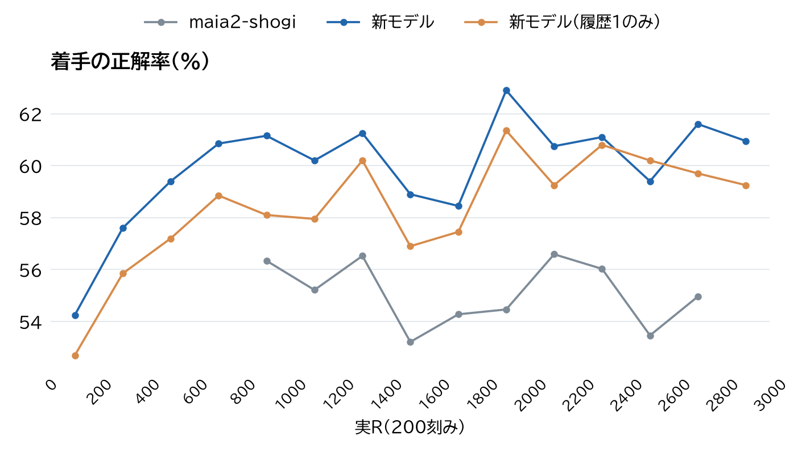
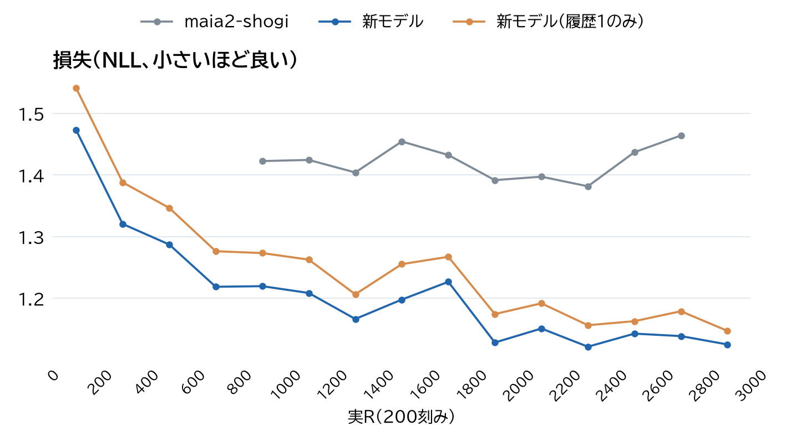
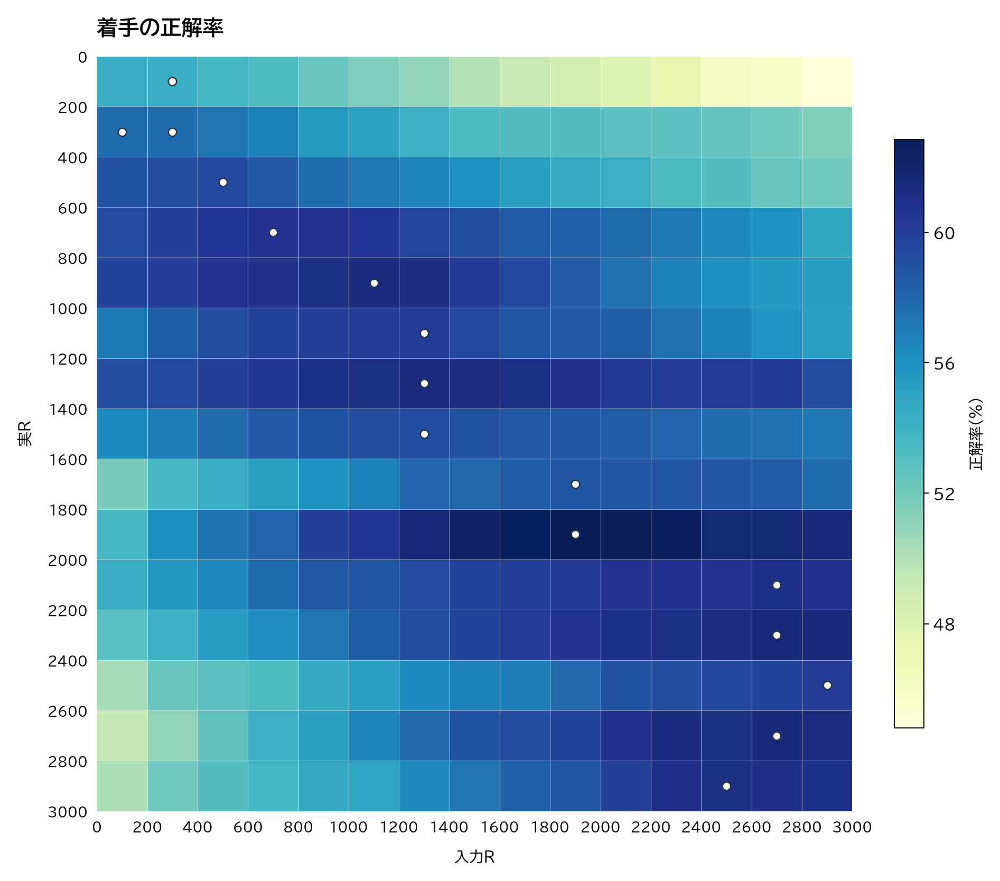

# shogi-human-policy

人間が次に指す手の確率分布を予測する将棋モデルです。
プレイヤのレーティング、残り持ち時間、最大8局面の履歴を入力することができ、状況やプレイヤの強さを考慮した予測をします。

作者の前作 [nyoki-mtl/maia2-shogi](https://github.com/nyoki-mtl/maia2-shogi) に続く取り組みで、事前学習済みの Transformer 重みを出発点に AdaLN でモデルに条件付けし、将棋倶楽部24の棋譜データ（約19億局面規模）で学習しています。
手法の詳細は、情報処理学会 第57回ゲーム情報学研究発表会にて発表した論文「[条件付き正規化を用いた棋力に応じた将棋方策関数の学習](https://www.ipsj.or.jp/kenkyukai/event/gi57.html)」（情報処理学会研究報告 Vol.2026-GI-57, No.2, pp.1-6, 2026年3月）に基づいています。

## クイックスタート

Python 3.11〜3.13 で動作します。

### CLI で試す

[Releases](https://github.com/nyoki-mtl/shogi-human-policy/releases) から `v0.1.1` のモデルファイル（`manifest.json` と `policy.safetensors` の2ファイル）を取得し、`models/v0.1.1/` に配置して実行します。

```console
uv sync
uv run shogi-human-policy predict --model models/v0.1.1 --position "startpos moves 7g7f 3c3d"
uv run shogi-human-policy predict --model models/v0.1.1 --file examples/records/opening.kif --ply 2 --top-k 5
```

| 入力できる情報                         | CLI オプション例                                                          |
| -------------------------------------- | ------------------------------------------------------------------------- |
| 平手初期局面・SFEN・着手列             | `--position "startpos moves 7g7f 3c3d"` / `--position "<SFEN> moves ..."` |
| 棋譜ファイル（KIF / KIFU / KI2 / CSA） | `--file game.kif`                                                         |
| 棋譜の途中局面                         | `--file game.kif --ply 30`（`0` は開始局面、省略時は末尾）                |
| 機械処理向け JSON 出力                 | `--format json`                                                           |

> 履歴も予測に使うため、SFEN 単体よりも棋譜ファイルや着手列を渡す方が精度が上がります。

### Python から使う

```python
from shogi_human_policy import Conditions, PolicyModel, Position

model = PolicyModel.from_directory("models/v0.1.1")
position = Position.from_file("examples/records/opening.kif", ply=2)

result = model.predict(
    position,
    Conditions(ratings=(1500, 1800)),  # (手番側R, 相手R)。時計は不明。
    top_k=5,
)
for row in result.as_rows(position):
    print(row["notation"], row["usi"], f"{row['probability']:.2%}")
```

- `Position.from_sfen(sfen, moves=[...])` や `Position.from_usi("startpos moves ...")` も利用できます。
- `Conditions()` のみなら R・時計とも不明として推論します。時計を指定する場合は `clocks=(手番側の利用可能秒数, 相手の利用可能秒数)` を渡します（本時間＋秒読みの合計。当該手の消費時間は含めません）。
- R と時計はそれぞれ2人分まとめて指定または省略します。棋譜ヘッダからの自動推定は行いません。

### Colab デモで試す

[](https://colab.research.google.com/github/nyoki-mtl/shogi-human-policy/blob/main/notebooks/demo.ipynb)

上のボタンから開き、標準CPUランタイムで上から順に実行してください。
`v0.1.1`のコードとモデルを自動取得します。

1. 「モデルの準備」を既定値のまま実行します。
2. 局面（SFEN / USI / 棋譜ファイル）と先手・後手のR / 時計を指定します。
3. 盤面と上位候補が表示されます。

手元のモデルを使う場合は「手元ファイル」を選び、wheel、`manifest.json`、`policy.safetensors`をアップロードしてください。

---

## 予測性能（`v0.1.1`）

数値はすべて **temperature 1・全合法手を分母とした正規化** で算出しています。

### 前作との同一局面比較

両モデルを**同じ16,010局面**（自他Rが800以上2800未満のvalidation）で比較しました。
括弧内は前作との差です。

| モデル | 正解率 | policy NLL（低いほど良い） |
| --- | ---: | ---: |
| `maia2-shogi v0.2.1` | 55.11% | 1.4211 |
| 本モデル | **60.46%** (+5.35pt) | **1.1730** (-0.2481) |

- **入力の寄与**（自然頻度 5,000局面）：R を省略すると NLL が `+0.0244`、履歴を省略（現在局面のみ）すると `+0.0504` 変化します。
- **手数帯別の比較**（共通範囲 16,010局面）：40〜79手の正解率差は +7.43pt、80手以降は +8.80pt でした。0〜19手は正解率差・NLL差とも95%区間が0を含みました。





`maia2-shogi` は対応範囲の R 800〜2799（共通範囲 16,010局面）、`新モデル` と `新モデル（履歴1のみ）` は全 R 帯 R 0〜2999（30,000局面）の成績です（厳密な同一 16,010局面の比較数値は [maia2-shogi との同一局面比較](docs/direct-comparison.md) を参照）。

### 入力Rに対する応答



R帯（200刻み）と手数帯の内訳を揃えた validation 30,000局面（各帯 2,000局面）での結果です。丸印は各実 R 帯で標本上最良だった入力帯を示します。低 R 帯では低い入力 R、高 R 帯では高い入力 R で正解率が高まる傾向が確認できます。

### 詳細レポート

- [評価結果と入力R応答](docs/evaluation.md) — 全体・R帯別・手数帯別の性能、入力省略の効果、実R×入力Rマトリクス、高R帯（2800〜2999）の確認
- [maia2-shogi との同一局面比較](docs/direct-comparison.md) — 公開 v0.2.1 との R帯別・手数別・R応答の直接比較
- [論文（GPW2026）に対応した詳細分析](docs/paper-analysis.md) — 一致パターン、順位別/着手別 JSD、確率校正（ECE）、入力対照実験

---

## モデル仕様

- **構造**: 95 token Transformer + AdaLN（14,723,681 パラメータ）、最大8局面の履歴を入力
- **学習データ**: 将棋倶楽部24の棋譜データ（約19億局面規模・自然頻度、評価用対局を除外）
- **出力**: 全合法手に対する確率分布
- **レーティング尺度**: 将棋倶楽部24
- **ライセンス**: コードは [MIT License](LICENSE) です。

詳細は以下を参照してください。

- [入力仕様・API・配布形式](docs/inference.md) — 局面・棋譜の扱い、Rと時計の定義、バッチ推論、`manifest.json` + `policy.safetensors` 仕様
- [モデルカード](docs/model-card.md) — 構造、学習データ、学習設定、数値検証

## 開発

```console
uv sync --group dev --group analysis
uv run pytest
uv run ruff check .
uv run ruff format --check .
uv build
```
