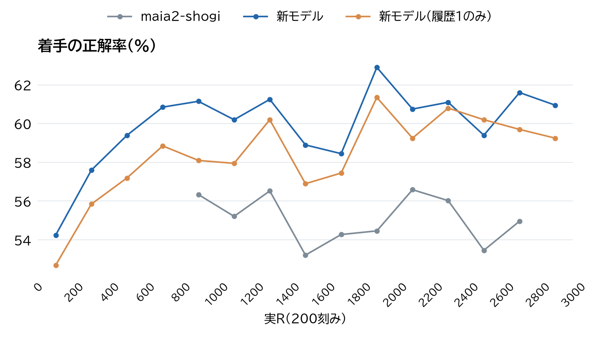
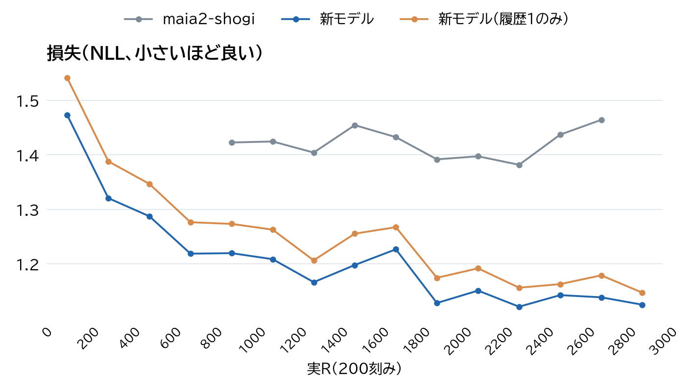
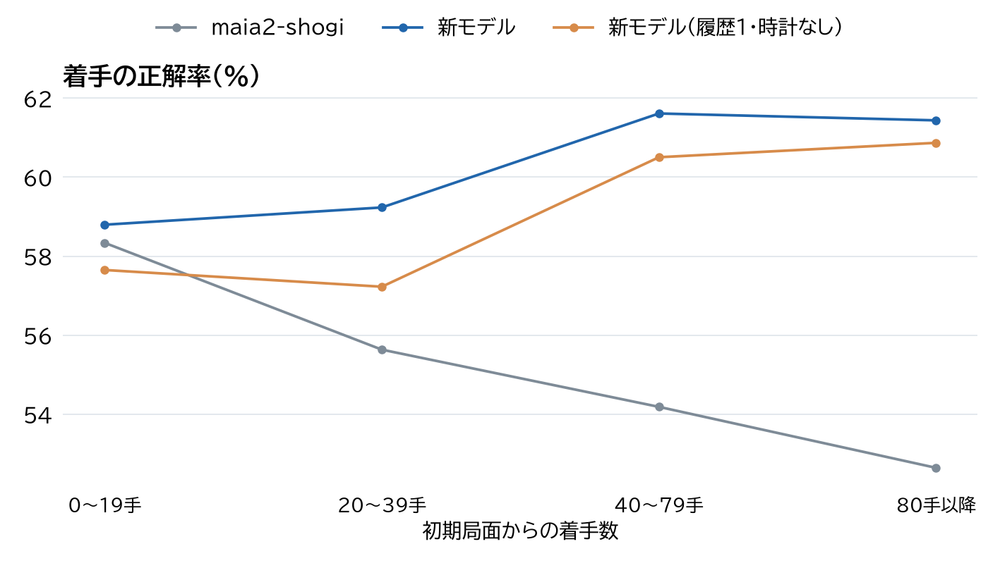
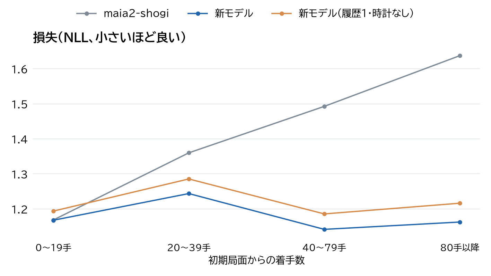
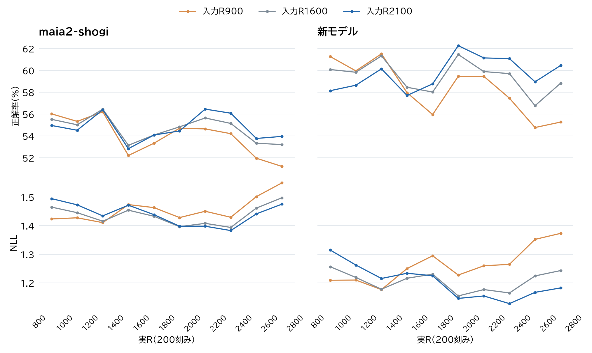
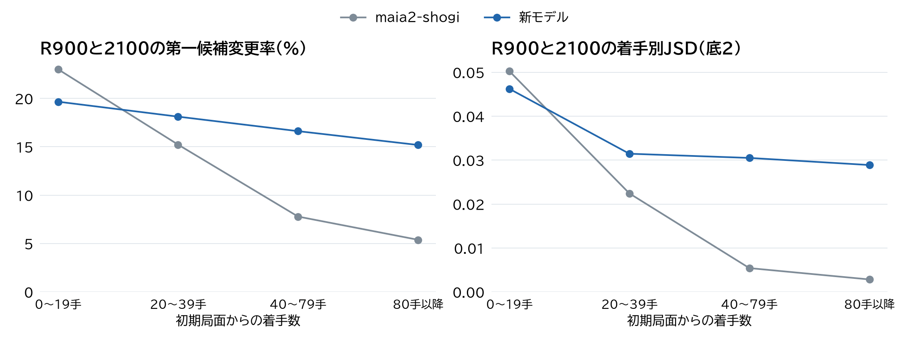

# maia2-shogi との同一局面比較

[README に戻る](../README.md)

作者の前作 [nyoki-mtl/maia2-shogi](https://github.com/nyoki-mtl/maia2-shogi)（公開 v0.2.1）と本モデル（`v0.1.1`）を、**同一の 16,010 局面（6,984 対局）・同一の合法手集合・temperature 1・全合法手正規化** で比較しました。

> [!NOTE]
> - 公開 `maia2-shogi` の元学習データは手元にないため、同モデルに対する完全な未学習データであることは保証できません（本モデルに対しては学習と対局分離済みの validation です）。
> - 両モデルで構造・事前学習・学習データ・更新数が異なるため、改善の要因を履歴や AdaLN 単体に帰属するものではありません。また、対局棋力の比較は行っていません。

---

## 全体の予測性能

| モデル | 正解率 | policy NLL |
|---|---:|---:|
| `maia2-shogi v0.2.1` | 55.11% | 1.4211 |
| 本モデル（通常入力） | **60.46%** | **1.1730** |
| 本モデル（履歴1・時計なし） | 59.26% | 1.2144 |

- 通常入力の本モデルは、正解率差 **+5.35 pt**（95% 区間: +4.70〜+5.97 pt）、NLL 差 **-0.2481**（95% 区間: -0.2605〜-0.2354）でした。
- 過去履歴と時計を省略した対照では、正解率差 +4.15 pt、NLL 差 -0.2067 でした。

---

## R 帯別比較

上図の `maia2-shogi` は対応範囲の 800〜2799（16,010 局面）、`新モデル` と `新モデル（履歴1のみ）` は全 R 帯 0〜2999（30,000 局面）の成績です。下の表は同一 16,010 局面で自他 R に観測値を入力した結果であり、評価した全 10 帯（800〜2799）で本モデルの平均一致率と NLL が改善しました。

| 実 R 帯 | Maia 正解率 | 本モデル正解率 | Maia NLL | 本モデル NLL |
|---|---:|---:|---:|---:|
| 800〜999 | 56.34% | **61.34%** | 1.4227 | **1.2089** |
| 1000〜1199 | 55.22% | **60.15%** | 1.4246 | **1.2042** |
| 1200〜1399 | 56.53% | **61.27%** | 1.4043 | **1.1676** |
| 1400〜1599 | 53.22% | **58.15%** | 1.4545 | **1.2160** |
| 1600〜1799 | 54.28% | **58.28%** | 1.4326 | **1.2272** |
| 1800〜1999 | 54.47% | **62.15%** | 1.3918 | **1.1452** |
| 2000〜2199 | 56.59% | **61.34%** | 1.3974 | **1.1541** |
| 2200〜2399 | 56.03% | **61.40%** | 1.3818 | **1.1196** |
| 2400〜2599 | 53.47% | **59.46%** | 1.4371 | **1.1410** |
| 2600〜2799 | 54.97% | **61.09%** | 1.4642 | **1.1458** |

---

## 手数帯別比較

| 初期局面からの着手数 | Maia 正解率 | 本モデル正解率 | Maia NLL | 本モデル NLL |
|---|---:|---:|---:|---:|
| 0〜19 手 | 58.34% | **58.80%** | 1.1686 | **1.1678** |
| 20〜39 手 | 55.63% | **59.23%** | 1.3602 | **1.2439** |
| 40〜79 手 | 54.19% | **61.61%** | 1.4929 | **1.1418** |
| 80 手以降 | 52.64% | **61.44%** | 1.6375 | **1.1626** |

- **0〜19 手の差は小さく、両指標の95%区間は0を含みました**。NLL差は -0.0008（95%区間: -0.0151〜+0.0127）、正解率差は +0.46 pt（95%区間: -0.64〜+1.52 pt）です。
- 40〜79 手での正解率差は +7.43 pt、80 手以降は +8.80 pt でした。

---

## 入力 R への反応の比較

相手 R を観測値に保ち、自分の入力 R だけを `900` / `1600` / `2100` へ変更して比較しました。

| R900 と R2100 の比較 | `maia2-shogi` | 本モデル |
|---|---:|---:|
| 第一候補変更率 | 12.23% | **17.33%** |
| 平均 TV | 0.09127 | **0.14215** |
| 着手別 JSD（底 2） | 0.01831 | **0.03383** |
| 順位別 Top-5 JSD（底 2） | 0.00899 | **0.01621** |

- 全体の第一候補変更率の差は +5.10 pt（95% 区間: +4.43〜+5.81 pt）でした。手数別では、0〜19 手は Maia 23.01% / 本モデル 19.66%、80 手以降は Maia 5.38% / 本モデル 15.18% でした。
- 自 R を 1600 固定から観測値に戻したときの NLL 改善幅は、`maia2-shogi` が **0.0159**（95% 区間: 0.0132〜0.0187）、本モデルが **0.0333**（95% 区間: 0.0296〜0.0369）でした。

---

## 測定条件と集計データ

- **抽出方法**: 既存の均等化 validation（30,000 局面）のうち、自他 R がともに 800 以上 2800 未満の局面から、10 の自 R 帯ごとに 20 手刻みの手数構成を揃えて各帯 1,601 局面（計 16,010 局面）を非復元抽出しました。
- **モデル変換**: `maia2-shogi` は 119 特徴量＋100 刻み R カテゴリに変換して ONNX で推論し、両モデルのラベル（2187 / 1496）を同じ USI 合法手集合へ対応させています。
- **区間推定**: 対局単位 bootstrap 2,000 回による個別 95% 区間です（同一プレイヤーの相関と多重比較は未補正）。
- **集計 JSON / 図の再生成**: [集計 JSON](metrics/v0.1.1-direct-maia2.json) から `uv run python tools/plot_direct_comparison.py docs/metrics/v0.1.1-direct-maia2.json --paper-diagnostics docs/metrics/v0.1.1-paper-diagnostics.json` で図を再生成できます。
