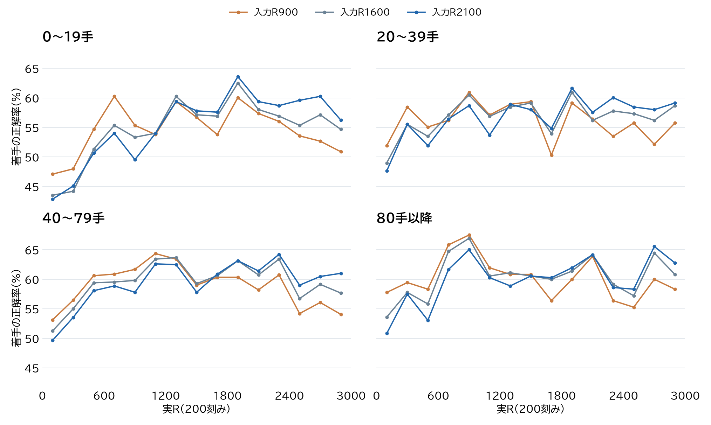
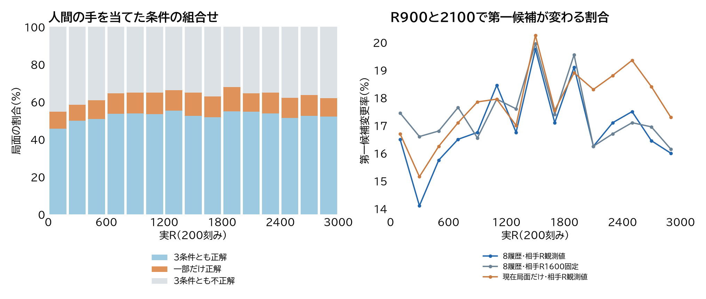
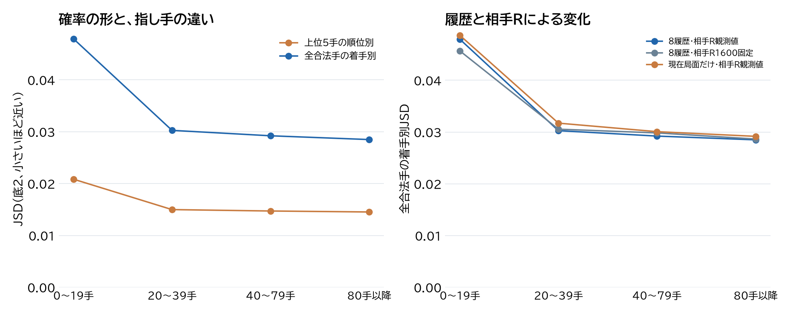
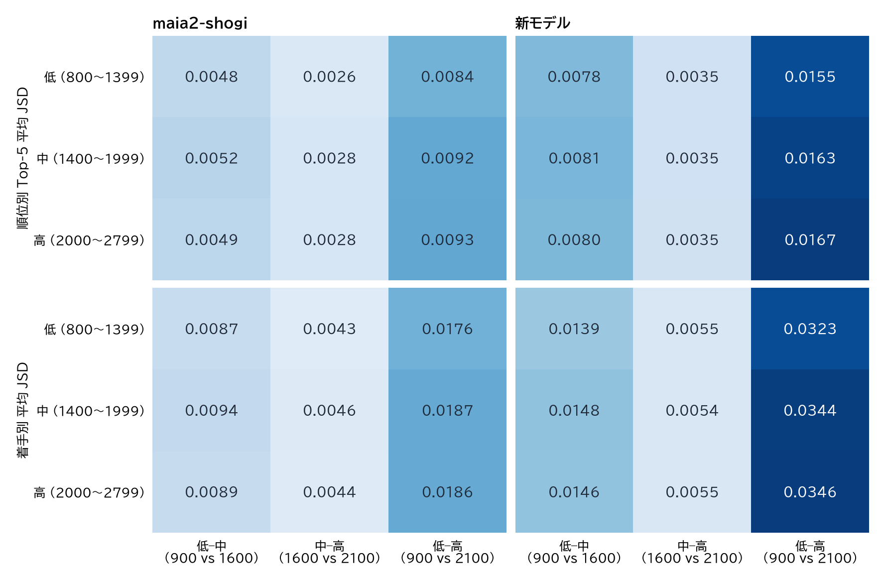
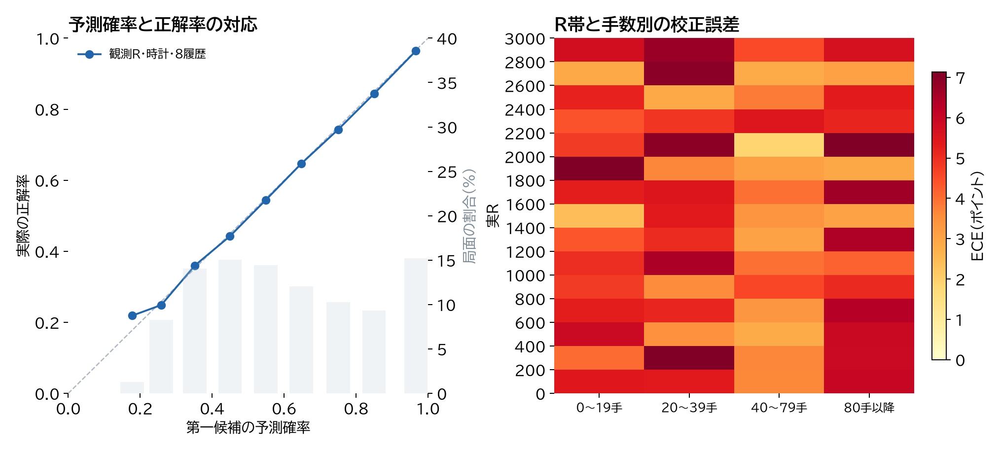
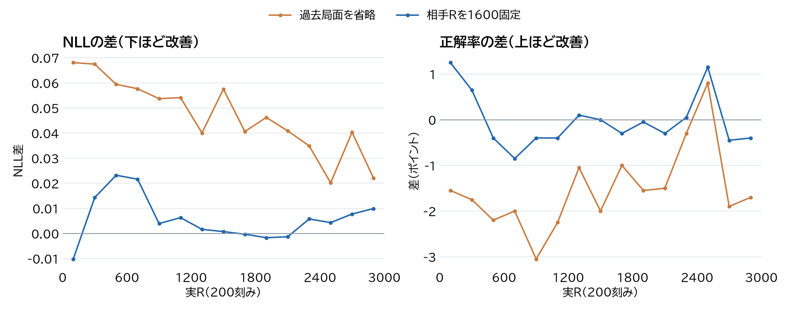

# 論文（GPW2026）に対応した詳細分析

[README に戻る](../README.md)

`v0.1.1` を、R 帯（0〜2999 の 200 刻み）と手数帯を揃えた validation 30,000 局面（各帯 2,000 局面）で分析しました（temperature 1・全合法手正規化）。

足立知己・竹内聖悟「Maia2におけるレート帯別モデルの一貫性と棋力差に関する分析」（GPW2026）の4.2〜4.5節に対応する指標を、本モデルの評価集合とR帯で測定しました。

---

## 1. 手数別の入力 R 応答

自 R の入力を低・中・高（900 / 1600 / 2100）に変え、相手 R・時計・履歴（最大 8 局面）を観測値に固定しました。

- **実 R 2000〜2999 における入力 R 2100 vs 900 の正解率改善**:
  - 0〜19 手: **+4.73 pt** / 20〜39 手: **+3.93 pt** / 40〜79 手: **+4.57 pt** / 80 手以降: **+3.11 pt**
  - 低 R 帯では低い入力 R、高 R 帯では高い入力 R がよく当たる傾向が、手数が進んでも維持されています。

観測 R を入力したときの手数別成績は以下の通りです（本評価集合では手数とともに一致率が一様に低下する傾向は見られませんでした）。

| 初期局面からの着手数 | 局面数 | 正解率 | policy NLL |
|---|---:|---:|---:|
| 0〜19 手 | 6,720 | 57.69% | 1.2346 |
| 20〜39 手 | 6,645 | 58.37% | 1.2572 |
| 40〜79 手 | 11,235 | 61.16% | 1.1780 |
| 80 手以降 | 5,400 | 62.00% | 1.1794 |

---

## 2. 一致パターンと第一候補の変化

低（900）・中（1600）・高（2100）の順に、各入力 R で人間の手と一致すれば `1`、外せば `0` として分類しました。

| 一致パターン（900 / 1600 / 2100） | 局面の割合 |
|---|---:|
| `111`（全条件で正解） | 52.44% |
| `000`（全条件で不正解） | 36.82% |
| 一部条件のみ正解（`001`〜`110` 合計） | **10.74%** |

- `R900` と `R2100` で第一候補が変わる局面は **16.94%**、3 条件がすべて同じ第一候補を選ぶ割合は **82.84%** でした。
- `000` は「3 条件とも人間の手と一致しなかった」だけで、3 条件が同じ手を選んだことを意味しません。

---

## 3. 順位別 JSD と着手別 JSD

論文に合わせて底 2 の JSD で測定しました。

| R900 と R2100 の比較 | 平均 JSD（底 2） |
|---|---:|
| 順位別 Top-5 確率（大きい順に並べて再正規化） | 0.01611 |
| 着手別（全合法手の同じ着手を対応付け） | 0.03351 |

| 手数区分 | 順位別 JSD ≧ 0.01 | R900 と R2100 で第一候補が変化 |
|---|---:|---:|
| 0〜19 手 | 61.01% | 19.79% |
| 20〜39 手 | 49.36% | 17.47% |
| 40〜79 手 | 48.06% | 15.90% |
| 80 手以降 | 46.70% | 14.89% |

- 順位別 JSD が `0.001` 以下の 2,562 局面でも、その **3.90%** で R900 と R2100 の第一候補が異なりました。順位別の確率形状が似ているだけでは、指し手が同じとは言えません。

### 棋譜レート帯別の平均 JSD（低–中 / 中–高 / 低–高）

評価棋譜のレート帯（低・中・高）ごとに、入力 R のペア（低 900・中 1600・高 2100）間の平均 JSD（底 2）を算出しました。

図は共通16,010局面を低R800〜1399、中R1400〜1999、高R2000〜2799に分けた平均です。入力R900 vs 2100の平均JSDは、本モデルが順位別 `0.0155〜0.0167`、着手別 `0.0323〜0.0346`、前作が順位別 `0.0084〜0.0093`、着手別 `0.0176〜0.0187`でした。

全 R 帯（0〜2999、30,000 局面）における本モデルの棋譜レート帯別平均 JSD は以下の通りです。

| 評価棋譜のレート帯 | 順位別 低–中 | 順位別 中–高 | 順位別 低–高 | 着手別 低–中 | 着手別 中–高 | 着手別 低–高 |
|---|---:|---:|---:|---:|---:|---:|
| 低（0〜999） | 0.0080 | 0.0038 | 0.0158 | 0.0139 | 0.0059 | 0.0323 |
| 中（1000〜1999） | 0.0080 | 0.0035 | 0.0158 | 0.0145 | 0.0054 | 0.0336 |
| 高（2000〜2999） | 0.0079 | 0.0035 | 0.0167 | 0.0146 | 0.0055 | 0.0347 |

---

## 4. 予測確率の校正（ECE）

自他 R と時計を観測値にした 8 履歴の推論では、全体の正解率 **59.92%**、Top-5 **93.21%**、NLL **1.2085**、ECE **0.59 pt**（第一候補の予測確率を 0.1 刻みに区切った加重平均絶対誤差）でした。

---

## 5. 履歴と相手 R の対照実験

自 R を観測値に保ったまま、相手 R または過去履歴だけを変更しました（95% 区間は対局単位 bootstrap 2,000 回）。

| 条件 | NLL | 基準からの NLL 差 | 差の 95% 区間 |
|---|---:|---:|---:|
| 全入力を観測値（基準） | 1.2085 | 0 | — |
| 相手 R だけ 1600 固定 | 1.2142 | +0.0057 | +0.0039〜+0.0075 |
| 現在局面だけ（履歴なし） | 1.2553 | +0.0469 | +0.0432〜+0.0507 |

- **履歴省略**: NLL 差は +0.0469 でしたが、自 R 900 vs 2100 による第一候補変更率は現在局面だけでも **17.79%** でした。履歴を省いた場合にも、入力Rに応じて予測が変化しています。
- **相手 R**: 観測自Rを保ち、相手Rだけを1600固定にするとNLLは +0.0057（95%区間: +0.0039〜+0.0075）変化しました。この条件では観測相手Rを使う方がNLLが低くなりました。自Rまで1600固定した対照での、相手R固定によるNLL差は -0.0288 でした。
